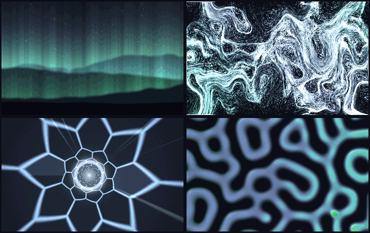

<div align="center">

# Kinetic

**A modular look-and-feel suite for [Omarchy](https://omarchy.org).**

Live wallpapers, rendered glass and fluid motion, as modules you can switch off, swap out or build on.


</div>

> [!WARNING]
> **Kinetic is in early development.** Expect bugs and breaking changes. Part
> of it runs inside Hyprland as a plugin, so a bug there can crash your
> session. Try it on a setup you can recover; `./uninstall.sh` removes it.

<div align="center">



</div>

The parts work together: the glass bends the real wallpaper behind it, and the
wallpaper moves with your windows when you switch workspaces. Every part is a
module: switch off what you don't want, add more from a link, or write your own.

## Contents

- [Features](#features)
- [Installation](#installation)
- [Quick start](#quick-start)
- [Modules](#modules)
- [Live wallpapers](#live-wallpapers)
- [Glass](#glass)
- [The pill bar](#the-pill-bar)
- [Motion and parallax](#motion-and-parallax)
- [Presets](#presets)
- [Updating](#updating)
- [Troubleshooting](#troubleshooting)
- [Files](#files)
- [Uninstalling](#uninstalling)
- [Development](#development)

## Features

- **33 live wallpapers** in your Omarchy theme's colors, reacting to sound or
  pausing when covered.
- **Glass** under the bar and behind see-through windows that bends, frosts
  and tints what's behind it.
- **A floating pill bar** built on Omarchy's own: one capsule or separate
  islands, in five styles.
- **A selection glow** around the focused window, animated, with an attention
  pulse.
- **Motion with parallax**: workspace and window animations, with the
  wallpaper sliding along at its own depth.
- **Presets**: a wallpaper, bar and motion, applied in one step.
- **Add-ons**: wallpapers and modules from a link, a folder or an archive.
- **One app and one CLI** for all of it.

## Installation

You need Omarchy with Hyprland 0.56 or newer. Omarchy already has everything
Kinetic builds with:

```bash
git clone https://github.com/deseret-engineer/Kinetic.git
cd Kinetic
./install.sh
```

The installer runs as your user, without root, and writes only Kinetic's own
files. It installs under `~/.local`, adds Kinetic to the launcher and to
**Omarchy menu → Appearance**, and starts the wallpaper engine. If you've
removed a package it needs, it names it. If the bar doesn't change, run
`omarchy restart shell`.

## Quick start

```bash
kinetic app                       # open the app
kinetic wall set fluid            # change the wallpaper
kinetic preset apply contours     # a wallpaper, a bar and motion together
kinetic bar preset lens           # a strongly bending glass bar
kinetic glass enable              # glass under the bar and behind see-through windows
kinetic light enable              # a glow around the focused window
kinetic motion preset parallax    # sliding workspaces with wallpaper parallax
kinetic status                    # everything, as JSON
kinetic reload                    # restart the engine, glass plugin, bar and app
kinetic update                    # what's installed (kinetic update check for newer)
```

The app is also in the launcher and under **Omarchy menu → Appearance →
Kinetic**. The 󰸉 widget on the bar handles the wallpaper; its gear (or
<kbd>o</kbd>) opens the app, where <kbd>Ctrl</kbd> + <kbd>1</kbd>–<kbd>9</kbd>
and <kbd>Ctrl</kbd> + <kbd>Tab</kbd> move between pages.

## Modules

```bash
kinetic modules                   # every module, on or off
kinetic light disable             # switch one off
kinetic light enable              # and back on
```

Switching a module on switches on what it needs; switching one off asks first
if others depend on it. The app's Modules page does the same.

| Module | What it does |
|---|---|
| [`wall`](modules/wall/) | Live wallpapers |
| [`bar`](modules/bar/) | The pill bar |
| [`glass`](modules/glass/) | Glass under the bar and behind windows |
| [`light`](modules/light/) | The glow around the focused window |
| [`motion`](modules/motion/) | Animations, parallax and pass-through switching |
| [`preset`](modules/preset/) | Saved presets across the other modules |

Each has `kinetic <module> help`.

### Adding and writing modules

```bash
kinetic module install https://github.com/someone/kinetic-thing   # or a folder, or an archive
kinetic module remove kinetic-thing
```

Kinetic shows everything it would install and waits for your yes. In the app,
paste a link on the Modules page or drop it onto the window.

To write one, see [MODULES.md](MODULES.md). The built-in modules use nothing
yours couldn't, so they double as examples.

## Live wallpapers


Some wallpapers simulate a world (particles, ants, fluid, a garden) that picks
up where it left off; others react to sound, the time of day or a workspace
switch.

```bash
kinetic wall list                 # every wallpaper
kinetic wall set aurora           # show one
kinetic wall next                 # the next one
kinetic wall pause                # hold the current frame
```

### Adding wallpapers

```bash
kinetic wall add https://github.com/someone/kinetic-wallpapers   # a link
kinetic wall add ~/Downloads/nebula.zip                          # an archive
kinetic wall add ~/src/my-wallpaper                              # a folder
kinetic wall add ./nebula --as nebula-2                          # under another name
kinetic wall added                                               # the ones you added
kinetic wall remove nebula
```

A source can hold one wallpaper or a collection; each must build before it's
added. In the app, paste a link on the Library page or drop it onto the window.

### Making your own

```bash
kinetic wall new mine             # scaffold one in ~/.config/kinetic/wallpapers/mine
kinetic wall set mine             # it reloads live as you edit
```

A wallpaper is GLSL shaders plus a `wallpaper.toml`, described in
[modules/wall/WALLPAPERS.md](modules/wall/WALLPAPERS.md). Share it as a Git
repository and anyone can `kinetic wall add` the link.

## Glass


The glass bends what's actually behind it, most at the rim, and can frost,
split into color fringes and catch a rim light. One set of options covers the
bar and the windows:

```bash
kinetic glass set refraction 24
kinetic glass set frost 2
kinetic glass set dispersion 0.3
```

| Option | Effect |
|---|---|
| `refraction` | How far the rim bends the image, in pixels |
| `frost` | Blur of what shows through; 0 is clear glass |
| `dispersion` | Color fringes where the glass bends most |
| `curvature` | Edge profile: below 1 a soft slope, above 1 a sharp rim |
| `saturation`, `brightness` | The color of what shows through |
| `specular`, `lightAngle` | Light catching the rim, and where it comes from |

Window glass goes behind windows you can see through: translucent ones and
terminals. Choose which apps count with
`kinetic glass apps <class|class*|tag> ...`, or cover more with
`kinetic glass windows floating` or `all`.

A small Hyprland plugin draws window glass. The installer builds it and Kinetic
rebuilds it when Omarchy updates Hyprland; `kinetic glass plugin` shows its state.

## The pill bar

The pill is Omarchy's own bar in a new shape, so it keeps up with Omarchy.

```bash
kinetic bar on liquid             # the pill, in the liquid style
kinetic bar shape islands         # separate capsules instead of one
kinetic bar set radius full
kinetic bar set tint accent
kinetic bar options               # every option, with its range and default
kinetic bar off glassy            # back to one of Omarchy's backgrounds
```

Styles: liquid, glass, frosted, solid and outline. Options apply live and are
saved under `bar.pill` in `~/.config/omarchy/shell.json`.

## Motion and parallax


`kinetic motion` sets how workspaces switch, windows open, close and move, and
menus and notifications appear, each with its own duration and curve. With
**parallax**, the wallpaper pans a fraction of a screen per workspace while the
windows move a whole one.

```bash
kinetic motion preset parallax    # slide with the wallpaper at 0.25 screens per workspace
kinetic motion set parallax 0.4   # deeper
kinetic motion set workspaces slidevert
kinetic motion set workspaceCurve spring
kinetic motion off                # Omarchy's own animations again
```

Presets: `parallax`, `vertical`, `deep`, `springy`, `snappy`, `calm` and `omarchy`.


**Pass-through** (`kinetic motion set passThrough true`) slides past every
workspace in between when you jump several at once.

`omarchy toggle animations` still turns all animation off.

## Presets

A preset is a wallpaper, a bar and motion, saved together.

```bash
kinetic preset list
kinetic preset apply ink
kinetic preset save mine          # save what's showing now
```

Yours are JSON files in `~/.config/kinetic/presets/`. Every part is optional,
and a preset changes only what it names, including the bar's and motion's own
presets:

```json
{
  "name": "Ink",
  "wall": { "wallpaper": "fluid", "preset": "Ink" },
  "bar": { "background": "pill", "preset": "lens" },
  "motion": { "preset": "parallax" }
}
```

Presets were called looks before 0.1.0: reinstalling moves saved looks over,
and `kinetic look` still works for now.

## Updating

Kinetic updates from a branch of the repository you installed it from: `master`
for releases, `dev` for the newest work. Until you choose, it follows the branch
you installed from.

```bash
kinetic update check              # look for a newer version
kinetic update apply              # install it (asks first), then restart the bar and the app
kinetic settings set updateBranch master
kinetic settings set updateCheck off   # stop the daily check when the app opens
```

In the app: **Settings**, the gear beside Reload. Updates are fetched into
Kinetic's own copy in `~/.cache/kinetic/source`, never your working copy.

## Troubleshooting

**The wallpaper didn't come up.** Check the engine's log:

```bash
journalctl --user -b -u kinetic-wall
```

**There's no glass behind windows.** Run `kinetic glass plugin`. After a
Hyprland update, the rebuilt plugin loads at your next login.

**The bar didn't change.** Run `omarchy restart shell`.

## Files

| Path | Contents |
|---|---|
| `~/.config/kinetic/` | Your settings, wallpapers and presets (the app's in `settings.json`) |
| `~/.config/omarchy/shell.json` | The bar's options, under `bar.pill` |
| `~/.local/state/kinetic/` | Live state and saved wallpaper worlds |
| `~/.local/share/kinetic/` | The installed suite and bundled wallpapers |
| `~/.local/share/kinetic-modules/` | Modules you added |
| `~/.cache/kinetic/` | Wallpaper previews, and the copy updates come from |

## Uninstalling

```bash
./uninstall.sh            # add --purge to also remove your settings and added modules
```

This removes everything Kinetic installed and gives the bar back to Omarchy.
Without `--purge`, your settings, wallpapers and added modules stay.

## Development

```bash
make -C modules/wall -j           # build the engine into modules/wall/build
tests/run.sh                      # every offline test
docs/media.py                     # re-render this README's images
```

Tests and media render offscreen, without touching your desktop.
[AGENTS.md](AGENTS.md) covers the layout and internals. Kinetic follows
[Semantic Versioning](https://semver.org); development builds carry `-dev`.
Changes are in [CHANGELOG.md](CHANGELOG.md).

## License

[MIT](LICENSE). Notices for the work of others that Kinetic includes or follows
are in [THIRD-PARTY.md](THIRD-PARTY.md) and under **Settings → Attributions**.
