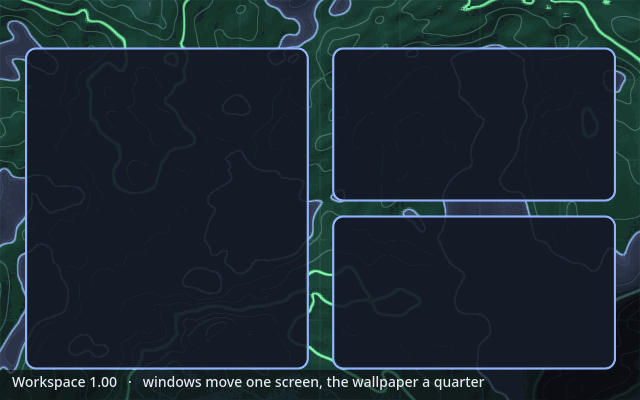

<div align="center">

# Kinetic

**A modular look-and-feel suite for [Omarchy](https://omarchy.org).**

Live wallpapers, rendered glass and fluid motion, as modules you can switch off, swap out or build on.


</div>

> [!WARNING]
> **Kinetic is in early development and may be unstable.** Expect bugs, rough
> edges and breaking changes between releases: options, commands and file
> formats can change without notice. Part of it runs inside Hyprland as a
> plugin, so a bug there can crash your session. Try it on a setup you can
> recover, and keep `./uninstall.sh` in mind.

<div align="center">


</div>

Kinetic is a modular look-and-feel suite for Omarchy (Arch Linux, Hyprland and
the Omarchy shell). Its core is a framework rather than a feature: one command,
one app, and a module system that installs modules, switches them on and off in
the right order, shows their pages in the app, and gives them shared tools for
working with Hyprland, the Omarchy shell and each other. Everything you see is
a module, including everything Kinetic ships with.

The built-in modules serve two purposes. They're ready to use: live wallpapers,
a floating glass bar, glass behind windows, a selection glow, workspace
animations with parallax, and saved looks. Because they know about each other,
the glass bends the real wallpaper behind it, and every workspace switch moves
the wallpaper in step with the windows, at its own depth. They're also
examples: each one is written exactly the way a module you add would be, so
together they're a working reference for building your own.

Any module can be switched off on its own, so you keep only the parts you want,
and new ones can be added from a link, a folder or an archive. Wallpapers are
just as easy to add: give Kinetic a link, a folder or an archive, or drop one
on the app, and it joins the library. See [Modules](#modules) and
[Adding wallpapers](#adding-wallpapers).

## Contents

- [Features](#features)
- [Requirements](#requirements)
- [Installation](#installation)
- [Quick start](#quick-start)
- [Modules](#modules)
- [Live wallpapers](#live-wallpapers)
- [Glass](#glass)
- [The pill bar](#the-pill-bar)
- [Motion and parallax](#motion-and-parallax)
- [Looks](#looks)
- [Troubleshooting](#troubleshooting)
- [Files](#files)
- [Uninstalling](#uninstalling)
- [Development](#development)
- [Versioning](#versioning)
- [License](#license)

## Features

- **A modular suite.** Every part is a module with its own commands, app pages
  and dependencies. Switch any of them off, add new ones from a link, a folder
  or an archive, or write your own using the built-in modules as examples.
- **33 live wallpapers** drawn by `kinetic-wall`, a native C engine (EGL and
  OpenGL ES 3 on the Wayland layer shell). They follow your Omarchy theme, can
  react to sound, pause when covered, and scale their own resolution to stay
  within a GPU budget.
- **Rendered glass** under the bar and behind see-through windows. It bends,
  frosts and splits the real pixels behind it, with an adjustable edge profile,
  dispersion, tint and rim light.
- **Window glass drawn by Hyprland itself.** A small Hyprland plugin draws the
  glass in the same frame as each window, so it stays locked to the window as
  it opens, closes, moves, tiles or switches workspaces.
- **A floating pill bar** built from Omarchy's own bar: one capsule or separate
  islands, in liquid, glass, frosted, solid or outline styles.
- **A selection glow** around the focused window, with breathe, flow and
  shimmer animations and an attention pulse.
- **Motion with parallax.** Kinetic sets Hyprland's animations and moves the
  wallpaper on exactly the same curve, a fraction of a screen per workspace.
- **Pass-through switching.** Jumping several workspaces slides through each one
  on a single curve, instead of cutting straight to the last.
- **Easy to add wallpapers.** Add one, or a whole collection, from a GitHub
  link, a folder or an archive with one command or by dropping it on the app.
  Each is compiled before it's added, so a broken one never reaches the screen.
- **Looks** save a wallpaper, bar and motion setup together and apply it in
  one step.
- **One app** for all of it, in the launcher and the Omarchy menu, with a
  matching CLI for scripts.

## Requirements

- Omarchy with Hyprland 0.56 or newer (Lua configuration).
- Build tools: `meson`, `ninja`, `gcc`, `pkg-config`, `jq` and `python3`.
- Libraries: Wayland, wayland-protocols, EGL and OpenGL ES (libglvnd), libpng,
  libjpeg-turbo, libwebp, and optionally PipeWire (for sound-reactive
  wallpapers).
- Hyprland's headers, which the `hyprland` package ships, to build the window
  glass plugin.

On Omarchy:

```bash
omarchy pkg add meson ninja jq python wayland wayland-protocols libglvnd libpng libjpeg-turbo libwebp pipewire
```

## Installation

```bash
git clone https://github.com/deseret-engineer/Kinetic.git
cd Kinetic
./install.sh
```

The installer runs as your user and needs no root access. It builds the
engine and the Hyprland plugin, installs Kinetic under `~/.local`, builds the
pill bar from your Omarchy's bar, adds Kinetic to the launcher and to
**Omarchy menu → Appearance**, and starts the wallpaper engine. Anything it
replaces is set aside in `~/.local/share/kinetic/replaced/`, never deleted.

If the bar doesn't change right away, restart the shell with
`omarchy restart shell`.

## Quick start

```bash
kinetic app                       # open the app
kinetic wall set fluid            # change the wallpaper
kinetic look apply contours       # a wallpaper and a bar together
kinetic bar preset lens           # a strongly bending glass bar
kinetic glass enable              # glass under the bar and behind see-through windows
kinetic light enable              # a glow around the focused window
kinetic motion preset parallax    # sliding workspaces with wallpaper parallax
kinetic status                    # everything, as one JSON object
```

The app is also in the launcher (**Kinetic**) and under **Omarchy menu →
Appearance → Kinetic**. The 󰸉 widget on the bar covers the wallpaper alone:
what's showing, its presets and parameters, and the library. Its gear (or `o`)
opens the app.

In the app, the sidebar lists the modules that are on, each with its pages.
<kbd>Ctrl</kbd> + <kbd>1</kbd>–<kbd>9</kbd> and <kbd>Ctrl</kbd> + <kbd>Tab</kbd>
move between pages.

## Modules

Kinetic is built around its modules. A module is a folder with two files: a
`module.json` that says what it is, what it needs and which pages it adds to the
app, and an executable `module.sh` that answers `enable`, `disable` and
`active` and carries the module's own commands. Kinetic finds it, lists it,
switches it on with what it needs, and shows its pages in the app.

```bash
kinetic modules                   # every module, on or off, and its version
kinetic light disable             # switch one off (the app's Modules page does the same)
kinetic light enable              # and back on, with whatever it needs
```

Switching a module on also switches on the modules it needs, and switching one
off asks first if others depend on it. A module that's off stops entirely and
leaves the app's sidebar.

### Built-in modules: features and examples

Kinetic's own modules live in [`modules/`](modules/) and use nothing a module
you add couldn't. Use them as they are, switch off the ones you don't want, or
read them as worked examples of the different things a module can do:

| Module | What it does | As an example of |
|---|---|---|
| [`light`](modules/light/) | The selection glow around windows | The smallest one: a few commands over the engine's options, and an app page |
| [`look`](modules/look/) | Saved looks across the other modules | A module that runs nothing in the background: just files and commands |
| [`motion`](modules/motion/) | Hyprland's animations, wallpaper parallax and pass-through | Writing Hyprland configuration safely: generated, verified with Hyprland, then installed |
| [`bar`](modules/bar/) | The pill bar: a capsule or islands, in five styles | Extending the Omarchy shell by hooking into its own bar instead of forking it |
| [`glass`](modules/glass/) | Glass under the bar and behind windows | Depending on another module, and shipping a Hyprland plugin |
| [`wall`](modules/wall/) | Live wallpapers on the native engine, and the glass under the bar | A native daemon run as a systemd service, with its own command-line interface |

Each has `kinetic <module> help`.

### Adding and writing modules

```bash
kinetic module install https://github.com/someone/kinetic-thing   # or a folder, or an archive
kinetic module remove kinetic-thing
```

Kinetic fetches the module and its dependencies, shows you everything it would
install, and installs nothing until you confirm. In the app, you can also paste
a link on the Modules page or drop a folder, archive or link onto the window.

To write one, start from [MODULES.md](MODULES.md), the guide to the manifest,
the commands and the tools Kinetic gives modules, and from the built-in module
closest to what you have in mind. A module can be shared as a Git repository
and installed by anyone with its link; other modules can depend on it.

The sections below cover the built-in modules in detail.

## Live wallpapers


Each wallpaper is a small folder of GLSL shaders and a `wallpaper.toml`. They
take their colors from the current Omarchy theme and change with it. Some
simulate a world (particles, ants, fluid, a garden) that's saved and picks up
where it left off; others react to sound, the time of day, the battery or a
workspace switch.

```bash
kinetic wall list                 # every wallpaper
kinetic wall set aurora           # show one
kinetic wall next                 # the next one in the library
kinetic wall pause                # hold the current frame
```

### Adding wallpapers

```bash
kinetic wall add https://github.com/someone/kinetic-wallpapers   # a link
kinetic wall add ~/Downloads/nebula.zip                          # an archive (.zip, .tar.gz, .tar.xz)
kinetic wall add ~/src/my-wallpaper                              # a folder
kinetic wall add ./nebula --as nebula-2                          # under another name
kinetic wall added                                               # the ones you added
kinetic wall remove nebula
```

A source can hold one wallpaper or a whole collection (wallpaper folders at its
top, or in a folder inside it). GitHub, GitLab and Codeberg links work, including
a branch and subfolder (`…/tree/main/wallpapers`). Kinetic compiles each
wallpaper before keeping it and skips any that don't build, then copies the rest
into `~/.config/kinetic/wallpapers/`, renders their previews, and the library
shows them right away. A wallpaper is only shaders and a settings file, so
nothing in it runs on your CPU.

In the app, paste a link, folder or archive into the field at the top of the
Library page, or drop it anywhere on the app's window.

### Making your own

```bash
kinetic wall new mine             # scaffold one in ~/.config/kinetic/wallpapers/mine
kinetic wall set mine             # saving its files now reloads it live
```

The format, uniforms and helpers are documented in
[modules/wall/WALLPAPERS.md](modules/wall/WALLPAPERS.md). To share one, put its
folder (or several) in a Git repository; anyone can add it with
`kinetic wall add <link>`.

## Glass


Kinetic's glass bends what's actually behind it. Each glass shape is a lens with
a rounded edge: the image bends most at the rim, along an edge profile you
choose. On top of the bend it can frost, split into color fringes (dispersion),
shift saturation and brightness, tint toward the theme for legible text, and
catch a rim light from any angle. One look applies to the bar and the windows:

```bash
kinetic glass set refraction 24
kinetic glass set frost 2
kinetic glass set dispersion 0.3
```

| Option | Effect |
|---|---|
| `refraction` | How far the rim bends the image, in pixels |
| `frost` | Blur of what shows through; 0 is clear glass |
| `dispersion` | Color fringes where the glass bends most |
| `curvature` | Edge profile: below 1 a soft slope, 1 rounded, above 1 a sharp rim with a flat middle |
| `saturation`, `brightness` | The color of what shows through |
| `specular`, `lightAngle` | Light catching the rim, and where it comes from |

**Under the bar.** The bar tells the wallpaper engine where its capsules are,
and the engine bends the wallpaper behind them. With the live wallpaper off,
the engine keeps showing your Omarchy background as a still image, so the
glass still has something to bend.

**Behind windows.** Glass goes only behind windows you can see through, since an
opaque window would hide it:

- windows Hyprland draws at 95% opacity or less, and
- apps that are see-through by their own settings, which Hyprland can't detect.
  By default this is every terminal (Omarchy tags them all `terminal`). Change
  the list with `kinetic glass apps <class|class*|tag> ...`, or turn it off
  with `kinetic glass apps none`.

`kinetic glass windows floating` and `kinetic glass windows all` widen it.
The window glass is drawn by Kinetic's Hyprland plugin, inside Hyprland's own
frame. It sits under the window the way Hyprland's blur does, and bends whatever
is behind it on that frame, including other windows. Its corners follow your
Hyprland rounding exactly. While window glass is on, Hyprland's own blur is
turned off, since the glass brings its own frost.

The installer builds the plugin and loads it at every login. Hyprland only
accepts a plugin built for its exact version, so Kinetic rebuilds it
automatically after an Omarchy update brings a new Hyprland.

```bash
kinetic glass plugin              # where it stands
kinetic glass plugin build        # build and load it by hand
```

## The pill bar

`kinetic.bar` isn't a copy of Omarchy's bar. Kinetic applies 16 small, named
hooks to the bar that ships with your Omarchy, so the pill keeps every upstream
change. An update hook rebuilds it after each Omarchy update. If an update ever
changes a part the hooks rely on, the rebuild stops, keeps the previous build
and notifies you.

```bash
kinetic bar on liquid             # the pill, in the liquid style
kinetic bar shape islands         # separate capsules instead of one
kinetic bar set radius full
kinetic bar set tint accent
kinetic bar options               # every option, with its range and default
kinetic bar off glassy            # back to one of Omarchy's backgrounds
```

Options apply live and are stored under `bar.pill` in
`~/.config/omarchy/shell.json`. Every option is defined once, in
`modules/bar/schema.json`, which the bar, the app and the CLI all read.

## Motion and parallax



`kinetic motion` sets Hyprland's animations: how workspaces switch (slide,
vertical slide, slide and fade, fade, or instant), how windows open, close and
move, and how menus and notifications appear. Each has a duration and a curve
(glide, smooth, snappy, linear, overshoot or spring).

With motion on, the wallpaper engine uses the same duration and curve as
Hyprland, so the wallpaper eases exactly with the windows. **Parallax** pans
the wallpaper a fraction of a screen per workspace while the windows move a
whole screen. Layered wallpapers move each layer at its own depth, and some
react to the switch itself with a gust, a flyby or a volley.

```bash
kinetic motion preset parallax    # slide, 500 ms glide, wallpaper at 0.25 screens per workspace
kinetic motion set parallax 0.4   # deeper
kinetic motion set workspaces slidevert
kinetic motion set workspaceCurve spring
kinetic motion show               # the Hyprland config and engine setting it produces
kinetic motion off                # Omarchy's own animations again
```

Presets: `parallax`, `vertical`, `deep`, `springy`, `snappy`, `calm` and `omarchy`.


**Pass-through** (`kinetic motion set passThrough true`) makes a jump across
several workspaces slide through each one on a single run of the switch curve,
instead of cutting straight to the last. Each extra workspace adds 110 ms
(`passMs`), or the whole trip takes the time of one switch with `passSameTime`.
A trip always ends on the workspace you chose. If something else switches
workspaces mid-trip (the bar, <kbd>Super</kbd> + <kbd>Tab</kbd>, an app asking
for focus), that switch wins.

Kinetic writes its animations to a single Hyprland toggle file and checks it
with Hyprland's own `--verify-config` first. `omarchy toggle animations` still
turns everything off.

## Looks

A look saves a wallpaper (with its preset and parameters), a bar and motion
together. Bundled looks live in `modules/look/looks/`, and your own in
`~/.config/kinetic/looks/`.

```bash
kinetic look list
kinetic look apply ink
kinetic look save mine            # snapshot what's showing now
```

```json
{
  "name": "Ink",
  "description": "Ink folding through water, seen through strongly bending lens islands",
  "wall": { "wallpaper": "fluid", "preset": "Ink", "params": { "speed": 1.2 } },
  "bar": { "background": "pill", "preset": "lens" },
  "motion": { "preset": "parallax" },
  "theme": "tokyo-night"
}
```

Every part is optional, and a look changes only what it names.

## Troubleshooting

**The wallpaper didn't come up at login.** The engine runs as
`kinetic-wall.service`. At login it waits for Omarchy's own background, startup
cover and login intro, then makes sure its wallpaper ends up on top. Every step
is logged:

```bash
journalctl --user -b -u kinetic-wall      # this login; -b -1 for the one before
```

For more detail, run `kinetic-wall daemon -v` or set `KINETIC_DEBUG=1`.

**There's no glass behind windows.** Check the plugin with
`kinetic glass plugin` and `hyprctl kinetic-glass status`. After a Hyprland
update, the new build loads at the next login.

**The bar didn't change.** Restart the shell with `omarchy restart shell`.

## Files

| Path | Contents |
|---|---|
| `~/.config/kinetic/wall.toml` | Engine options and per-wallpaper defaults |
| `~/.config/kinetic/wallpapers/` | Your own wallpapers |
| `~/.config/kinetic/looks/` | Your own looks |
| `~/.config/kinetic/motion.json` | Motion settings |
| `~/.config/omarchy/shell.json` | The bar's options, under `bar.pill` |
| `~/.local/state/kinetic/` | Live state, saved wallpaper worlds and signals between parts |
| `~/.local/state/omarchy/toggles/hypr/` | Kinetic's Hyprland toggles: `zz-kinetic-bar.lua`, `zz-kinetic-windows.lua`, `kinetic-motion.lua`, `kinetic-app.lua`, `kinetic-plugin.lua` |
| `~/.local/share/kinetic/` | The installed suite and bundled wallpapers |
| `~/.local/share/kinetic-modules/` | Modules you added |
| `~/.local/lib/kinetic/` | The Hyprland plugin |
| `~/.cache/kinetic/wall/thumbs/` | Wallpaper previews |

## Uninstalling

```bash
./uninstall.sh            # add --purge to also remove your settings and added modules
```

This stops and disables `kinetic-wall.service` and returns the bar to Omarchy's
own (a pill background becomes glassy). It removes Kinetic's shell plugins,
menu rows, launcher entry, post-update hook, Hyprland toggles and plugin, and
the `kinetic*` commands in `~/.local/bin`.

## Development

```bash
ninja -C modules/wall/build       # build the engine (first: meson setup modules/wall/build modules/wall --prefix ~/.local)
tests/run.sh                      # every offline test
docs/media.py                     # re-render the images in this README, offscreen
```

Everything in the test suite and in `docs/media.py` runs offscreen, without
touching the running desktop. [AGENTS.md](AGENTS.md) describes the layout,
build and internal contracts in detail.

## Versioning

Kinetic follows [Semantic Versioning](https://semver.org). Versions are
`MAJOR.MINOR.PATCH`: a release that breaks compatibility raises MAJOR, one
that adds features raises MINOR, and one that only fixes bugs raises PATCH.
While MAJOR is 0, as now, Kinetic is in initial development and any release
may change options, commands or file formats. Modules are versioned the same
way, so a module can require a minimum version of Kinetic or of another module
(`>=1.2`).

## License

[MIT](LICENSE)
